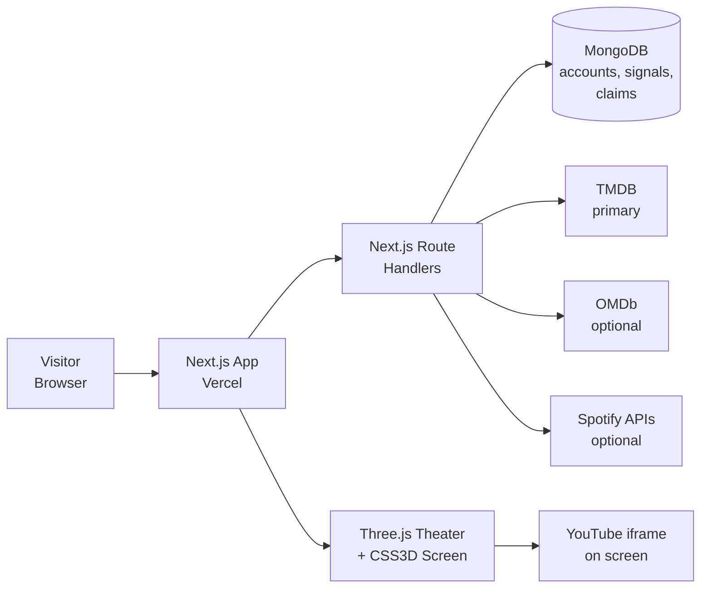
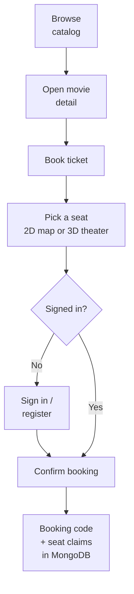

# Reelscape

[](https://github.com/Gautam215/Music-and-Movies-show/actions/workflows/ci.yml)
[](https://music-and-movies-show.vercel.app/)

Reelscape is a Next.js movie-discovery and cinema-ticket experience. Browse films, television, and anime, save titles, pick seats on a 2D map or in a sign-in-gated 3D theater, and watch a selected title's trailer on the theater screen.

**Live demo:** [music-and-movies-show.vercel.app](https://music-and-movies-show.vercel.app/)

> Read this first: showtimes, displayed prices, and the 40-seat base map are sample data, not live cinema inventory. The checkout form is demo UI — no payment provider is called and no payment is processed. Do not enter real card details.

## Quick start

Requires Node.js 22 and npm, matching CI.

```bash
npm ci
cp .env.example .env.local
npm run dev
```

Open `http://localhost:3000`. Set `MONGODB_URI` for accounts and persistent ticket/user data. Set the relevant server-side API credentials to enable TMDB, OMDb, YouTube fallback, Spotify, or shared Redis behavior. See [Environment variables](#environment-variables).

## What you can do

- **Discover** films, television, and anime from TMDB feeds when `TMDB_READ_ACCESS_TOKEN` is configured, with curated and optional OMDb fallbacks. Open a movie detail dialog, save or unsave it, and share it through the Web Share API or clipboard. Sharing uses the current page URL; it does not generate a unique permalink per movie.
- **Book in 2D** — choose a movie, a listed day and showtime, and seats from the 2D seat map. Guests can use the 2D surface; the server requires a signed-in account to confirm a booking. Confirmation writes a booking code and seat claims to MongoDB.
- **Book in 3D** — signed-in users can use the Three.js theater: five curved, raked rows with raised platforms, center/side aisles, and stairs; distinct colors for available, selected, held, and occupied seats; a per-seat eye-level camera pose aimed at the screen; and eased camera transitions between overview, seat POV, and screen view (reduced-motion mode skips those transitions). 3D is sign-in-gated, not premium-subscription-gated: the current server model sets `canAccess3DTheater` for every authenticated account.
- **Watch the trailer on the screen** — there is no Watch Trailer button in the movie detail dialog. Trailer playback belongs to the 3D ticket flow: select a seat, go to its POV, and play the trailer on the cinema screen (a CSS3D YouTube iframe aligned to the screen mesh, not a full-page overlay or WebGL video texture). Playback is user-started (`autoplay=0`). With a TMDB token configured, the trailer API first checks videos for the selected TMDB movie or TV ID; if TMDB has no usable YouTube trailer, the server may use the YouTube Data API only when `YOUTUBE_API_KEY` is configured. Fallback candidates must match the selected title, have no conflicting release year, and be public, processed, embeddable, and not region-restricted. Ambiguous matches are rejected, and when no reliable trailer is found the screen reports: `No preview is available for this title.`
- **Use an account** — MongoDB-backed email/password accounts and sessions, saved titles, viewing history, user signals, and confirmed seat claims. Movie saves and viewing history persist for signed-in users; guest saves are temporary UI state.
- **Listen (optional)** — soundtrack features with optional Spotify OAuth and API credentials. The optional projector ambience is synthesized with Web Audio oscillators and routed through an HRTF panner at the screen; it starts only after the user activates its control. Trailer audio stays inside the cross-origin YouTube player and is not spatialized by this app.

## How it fits together

Diagram plan (per the diagram-design skill): two diagrams, both kept under its 9-node budget, rendered as Mermaid so they display directly on GitHub. The skill's HTML style tokens are not used here because a GitHub README cannot render a standalone HTML diagram file inline; Mermaid is the faithful GitHub-native form. One focal path per diagram: the booking path in diagram 2, the request path in diagram 1.

### 1. Architecture



Reading it: the browser talks to the Next.js app on Vercel. Route handlers are the only server path to MongoDB and to the external movie/music APIs. The 3D theater runs in the browser; its screen is a CSS3D YouTube iframe, not a server-rendered video. Convex files remain as scaffolding only — the active account and ticket APIs use MongoDB, and `NEXT_PUBLIC_CONVEX_URL` is not used. There is no stream server in this repository: the 3D client can consume an externally hosted WebSocket or SSE URL (`NEXT_PUBLIC_TICKET_SEAT_STREAM_URL`), and without one it refreshes seat data through the REST seat-map API.

### 2. Booking journey



What this diagram does not show, on purpose: there is no payment step and no server-side seat hold. Selecting a seat does not create a server-side expiring hold; the countdown shown in the UI is not a payment or inventory guarantee. Seats are only claimed when the confirmation request succeeds.

## Tech stack

Versions from `package.json` at the time of this redesign:

| Area | Stack |
| --- | --- |
| Web app | Next.js 16, React 19, TypeScript, Tailwind CSS, App Router, Node.js route handlers |
| 3D | Three.js, WebGL, CSS3D renderer for the screen iframe |
| Data | MongoDB (driver 6.x) for accounts, sessions, favorites, viewing signals, booking records, and confirmed seat claims |
| Movie/music services | TMDB (primary), OMDb (optional enrichment), YouTube Data API (optional trailer fallback), Spotify OAuth/APIs (optional) |
| UI | Lucide React icons; hand-rolled CSS keyframes and `requestAnimationFrame` motion (no animation library in `package.json`) |
| Scaffolding only | Convex files (`convex/schema.ts`, `convex/bookings.ts`) are not the active account/ticket path — see the note under Architecture |

## API routes

| Group | Routes |
| --- | --- |
| Health | `GET /api/health` — returns `{ ok, database, time }`; 200 when up, 503 when a configured MongoDB cannot be reached within 3 seconds |
| Auth | `POST /api/auth/register`, `POST /api/auth/signin`, `GET /api/auth/session`, `POST /api/auth/signout` |
| Tickets | `GET /api/tickets/seat-map`, `POST /api/tickets/confirm` |
| Movies | `GET /api/movies/trailer` |
| User data | `GET` / `POST /api/user-signals`, `POST /api/viewing-history`, `GET /api/notifications` |
| Spotify | `GET /api/spotify/login`, `GET /api/spotify/callback`, `GET /api/spotify/session`, `GET /api/spotify/token`, `GET /api/spotify/tracks`, `GET /api/spotify/playlist`, `POST /api/spotify/player` |
| Development only | `POST /api/dev/premium-fixture` — in-memory QA fixture, only when `NODE_ENV=development`; it is not a production account or paid entitlement |

## Screenshots

These checked-in captures cover the main app surfaces; the automated capture script does not authenticate or render the 3D theater.

| Surface | Desktop | Mobile |
| --- | --- | --- |
| Home | [home-desktop.png](screenshots/home-desktop.png) | [home-mobile.png](screenshots/home-mobile.png) |
| Songs | [songs-desktop.png](screenshots/songs-desktop.png) | [songs-mobile.png](screenshots/songs-mobile.png) |
| Tickets | [tickets-desktop.png](screenshots/tickets-desktop.png) | [tickets-mobile.png](screenshots/tickets-mobile.png) |
| Profile | [profile-desktop.png](screenshots/profile-desktop.png) | [profile-mobile.png](screenshots/profile-mobile.png) |

## Security — what is implemented

These controls are implemented; they are not a guarantee that the application is free of security risk.

- Passwords are stored as scrypt-derived hashes with per-password random salts and timing-safe comparison. Session tokens are random, and only their SHA-256 hashes are stored in MongoDB.
- Session cookies are `HttpOnly` and `SameSite=Lax`, gain the `Secure` attribute in production, and expire after 30 days. MongoDB TTL indexes support expiry cleanup.
- Protected ticket, seat-map, profile, and user-signal operations derive the user identity from the server-side session. Ticket and trailer inputs are type-, length-, and format-checked before database or external API calls. MongoDB filters are constructed by server code from validated scalar fields; request bodies are not passed through as raw MongoDB query objects.
- `proxy.ts` rate-limits `/api/*` requests: 120 requests per 60 seconds by default. It uses an atomic Redis operation when an Upstash-compatible endpoint is configured and a process-local in-memory fallback when Redis credentials are absent or Redis fails. The fallback is not shared between server instances. If a configured Redis store fails, behavior is fail-open by default; `RATE_LIMIT_FAIL_CLOSED=true` returns `503` instead. Without Redis credentials, the in-memory fallback is used regardless of that flag.
- Selected state-changing routes reject a foreign `Origin` or `Referer`. There is no separate CSRF token. The helper accepts requests when both headers are absent for client compatibility. No wildcard CORS policy is configured.
- Response headers include a Content Security Policy, `X-Content-Type-Options`, `X-Frame-Options`, `Referrer-Policy`, `Permissions-Policy`, and `Cross-Origin-Opener-Policy`. The current CSP includes inline script/style allowances required by the app.
- Server-only API credentials must not use a `NEXT_PUBLIC_` name. Personal JSON responses use private/no-store caching, and route errors return generic client messages while details are logged server-side.

## Environment variables

Copy `.env.example` to `.env.local`. It contains empty credential placeholders and safe local defaults. Values beginning with `NEXT_PUBLIC_` are included in browser-visible code and must never contain secrets. The code does not currently read an `AUTH_SECRET`.

| Variable | Scope | Purpose |
| --- | --- | --- |
| `MONGODB_URI` | Server secret | Required for registration, sessions, saved signals, and booking records |
| `MONGODB_DB_NAME` | Server setting | Database name; defaults to `reelscape` |
| `TMDB_READ_ACCESS_TOKEN` | Server secret | Enables live TMDB feeds and primary trailer lookup |
| `YOUTUBE_API_KEY` | Server secret, optional | Enables the validated YouTube trailer fallback |
| `OMDB_API_KEY` | Server secret, optional | Enables OMDb enrichment. `OMDB_MOVIE_IDS` optionally overrides the configured IMDb ID list |
| `SPOTIFY_CLIENT_ID` | Server OAuth setting | Spotify app client ID |
| `SPOTIFY_CLIENT_SECRET` | Server secret | Spotify app secret; keep it server-side |
| `SPOTIFY_REDIRECT_URI` | Server OAuth setting | Must match the Spotify app's configured callback URL |
| `NEXT_PUBLIC_APP_URL` | Public URL | Application origin used when constructing the Spotify callback URL if no redirect URI is set |
| `UPSTASH_REDIS_REST_URL` | Server URL, optional | Shared rate-limit store. `REDIS_REST_URL` is also accepted |
| `UPSTASH_REDIS_REST_TOKEN` | Server secret, optional | Redis REST token. `REDIS_REST_TOKEN` is also accepted |
| `RATE_LIMIT_WINDOW_MS` | Server setting | Rate-limit window; default `60000` |
| `RATE_LIMIT_MAX_REQUESTS` | Server setting | Requests per window; default `120` |
| `RATE_LIMIT_KEY_PREFIX` | Server setting | Redis key prefix; default `reelroom:api` |
| `RATE_LIMIT_FAIL_CLOSED` | Server setting | Default `false`; set `true` to return `503` when a configured Redis request fails. If Redis URL/token is unset, the local fallback remains active |
| `NEXT_PUBLIC_THEATER_3D_ENABLED` | Public feature flag | Three.js theater is enabled by default; set to `false` to disable it |
| `NEXT_PUBLIC_TICKET_SEAT_STREAM_URL` | Public URL, optional | External WebSocket (`ws:`/`wss:`) or SSE (`http:`/`https:`) seat-event endpoint. Do not put credentials in this URL; the stream server is not part of this repository |
| `ENABLE_PREMIUM_TEST_FIXTURE` | Development-only setting | Enables the in-memory QA fixture only when `NODE_ENV=development`; it is not a production account or paid entitlement |

## Testing

Run the commands defined in `package.json` and `.github/workflows/ci.yml`:

```bash
npm run format:check
npm run typecheck
npm run lint
npm run audit
npm test
npm run build
npm run test:api
```

`npm run test:api` expects a completed production build and starts its own Next.js server on port 3100. The unit tests use Node's built-in test runner. Security-related assertions are part of the unit and API smoke suites; there is no separate penetration-test suite.

For production-style screenshots, install Chromium, then run the built app in one terminal and capture it from another:

```bash
npx playwright install chromium
npm run build
npm run start
```

In a second terminal, run `npm run screenshots`. The script captures Home, Songs, Tickets, and Profile at 1440×1000 desktop and 375×812 mobile browser viewports. To capture another running site, set `BASE_URL`, for example `BASE_URL=https://music-and-movies-show.vercel.app npm run screenshots`.

## Deployment and self-healing

- **Platform:** Vercel. **Production URL:** [music-and-movies-show.vercel.app](https://music-and-movies-show.vercel.app/)
- GitHub Actions deploys same-repository PR previews after verification and screenshots pass. Pushes to `main` deploy production after those jobs pass; fork PR previews are skipped because repository secrets are not exposed to fork workflows. The workflow reads these GitHub Actions secrets: `VERCEL_TOKEN`, `VERCEL_ORG_ID`, and `VERCEL_PROJECT_ID`. Store values in repository Actions secrets, not in this README or `.env.example`.
- **Self-healing (beginner/intermediate level):** Vercel has no long-running server process, so PM2/systemd/Docker restart does not apply here. Vercel already restarts a crashed serverless instance on the next request, and this repo adds two small pieces that make that usable:
  - `GET /api/health` — returns `{ ok, database, time }`; 200 when up, 503 when a configured MongoDB cannot be reached within 3 seconds. It never crashes on a failed check. Verified live on 2026-10-28: `{"ok":true,"database":"up"}`.
  - `lib/mongodb.ts` — if a MongoDB connection fails, the rejected connection is cleared instead of being kept forever, so the next request tries to connect again.
  - To notice downtime without opening the site yourself, point a free uptime monitor (for example UptimeRobot) at `https://music-and-movies-show.vercel.app/api/health` every 5 minutes. The monitor alerts you when it stops getting 200, and its regular pings also keep a Vercel instance warm.
  - What this does not do: it does not restart anything in milliseconds, and it does not give Netflix-style multi-server failover. A cold Vercel instance still takes seconds to start on the first request after a crash or a long idle period.

### Current CI status — read honestly

The old README listed a verified CI snapshot from 2026-10-01 (commit `2860a19`, 0 vulnerabilities). That snapshot is now stale and is deliberately not repeated here. As of 2026-10-28, for commit `e2a3d4c` (CI run #58): formatting, type-check, and lint passed, but `CI / verify` failed at the **Audit dependencies** step with 5 pre-existing dependency vulnerabilities (1 moderate, 3 high, 1 critical: next, postcss-selector-parser, sharp, source-map-js, zod) — no new dependency was added by that commit, so this is not a failure of the health/mongodb code. Unit tests, build, and API checks did not run in that CI job because the job stopped at audit. Separately, the Vercel integration check for that commit was successful ("Deployment has completed"), and the live `/api/health` response above confirms the new code is deployed. Do not run `npm audit fix` / upgrade dependencies without a separate decision — that changes dependency versions and needs its own review.

## Browser verification — what is and is not verified

**Verified:**

- The automated screenshot job covers 1440×1000 desktop and 375×812 mobile browser emulation for Home, Songs, Tickets, and Profile.
- A manual production spot-check loaded Home and the ticket flow at 1440×900 and 390×844 browser viewports. The 3D sign-in prompt was observed, and neither viewport had horizontal overflow.

**Not verified:**

- Premium 3D runtime verification was not available in this environment. The authenticated WebGL scene, seat POV transitions, on-screen trailer playback, seat changes during playback, and spatial cues have not been exercised in an authorized signed-in browser session.
- The unit tests cover geometry and selection helpers; they are not a live WebGL/browser test.

## Known limitations

- Showtimes, displayed prices, and the 40-seat base map are sample data, not live cinema inventory. MongoDB records this app's confirmed seat claims, but no cinema operator inventory service is integrated.
- The seat-selection countdown is presentation-only; seats are not held on the server until the confirmation request. Confirmations create records and booking codes but do not charge a card, call a payment provider, or send a ticket email.
- 3D is sign-in-gated, not premium-subscription-gated. The current code grants the 3D capability to all authenticated users.
- Trailer availability depends on TMDB data and, for fallback search, a configured YouTube API key. The player requires a user gesture to start; trailer audio remains under YouTube's control and is not spatialized.
- WebGL support and performance vary by device. The 2D seat map is the fallback; authenticated 3D behavior has not been runtime-verified here.
- Shared seat events require an external WebSocket/SSE service if configured. No such service is deployed from this repository. Without one, seat data refreshes through the REST API.
- Without shared Redis, rate limiting falls back to process-local memory and is not coordinated across server instances.
- Spotify, OMDb, TMDB, YouTube, MongoDB, and Redis capabilities depend on their respective services and configuration.

## Security disclosure

For a suspected vulnerability, use GitHub's private vulnerability reporting for this repository when available. If it is unavailable, contact the maintainers privately through GitHub. Please do not post credentials or unpatched exploit details in a public issue.

## License

This project is licensed under the MIT License. See [LICENSE](LICENSE).
